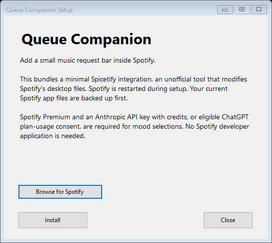
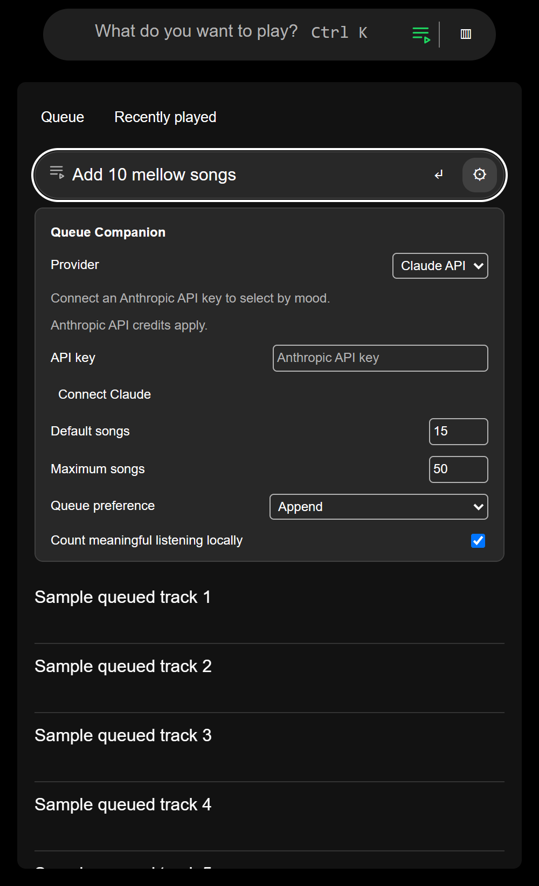

# Queue Companion

<table>
  <tr>
    <th>Windows installer</th>
    <th>Queue Companion in Spotify</th>
  </tr>
  <tr>
    <td valign="top"></td>
    <td valign="top"></td>
  </tr>
</table>

*Rendered UI samples: the installer in fresh-install mode, and the current plugin in a Spotify layout fixture with sample queue data.*

**Version 0.2.6.** Queue Companion supports ChatGPT and Claude API and bundles a minimal Spicetify integration. Requests for music like a playlist or your recent plays discover different songs using taste references. Explicit requests for songs from a playlist stay inside it. Discovery can also mix in a counted portion of playlist originals. Discovery includes related-artist suggestions, duplicate recovery and parallel Spotify checks. The optional Spicetify splash, Store and manager are omitted. Queue Companion-owned installations keep normal Spotify startup, including after Repair.

A larger request bar inside Spotify’s Queue panel. The small queue icon immediately before Browse in Spotify’s Search opens Queue and focuses the bar. The request bar takes its own space below the Queue tabs, leaving native queue controls accessible. Songs go into Spotify’s real queue; Spotify handles playback. This is an unsigned Windows x64 preview. Queue Companion code is MIT licensed; bundled components retain their own licenses, including LGPL Spicetify and GPLv3 modules. Their notices and corresponding upstream source archives are included in `vendor`.

## Download

Get the [Windows x64 installer ZIP](https://github.com/W7RP/spotify-queue-companion/releases/download/v0.2.6/QueueCompanion.Setup.zip) or [installer executable](https://github.com/W7RP/spotify-queue-companion/releases/download/v0.2.6/QueueCompanion.Setup.exe). The [0.2.6 release](https://github.com/W7RP/spotify-queue-companion/releases/tag/v0.2.6) contains checksums and the matching source archive. The [saved release](https://github.com/W7RP/spotify-queue-companion/releases/tag/storage-2026-10-11) retains the original distribution archives.

**macOS preview (macOS 15 or newer):** download the [Apple Silicon installer](https://github.com/W7RP/spotify-queue-companion/releases/download/v0.2.6-macos.2/QueueCompanion-0.2.6-macos.2-macOS-arm64.dmg) or [Intel installer](https://github.com/W7RP/spotify-queue-companion/releases/download/v0.2.6-macos.2/QueueCompanion-0.2.6-macos.2-macOS-x64.dmg). Preview 2 fixes the installer window-cleanup crash in preview 1. The Windows `.exe` does not work on a Mac. See [Mac installation and preview limits](docs/MACOS-INSTALL.md). macOS uses the same Spotify panel with Keychain credentials and an invisible helper at login; queue replacement awaits a real Mac Spotify test.

**iPhone web app preview:** [Open Queue Companion](https://queue-companion-mobile.quirkycoati256.chatgpt.site) in Safari and add it to the Home Screen. This hosted preview is currently owner-only. Connect Spotify Premium and choose a music source: Spotify library for source-based mixes without an AI key, or Claude API for free-text discovery using your API credits. ChatGPT site login provides app access only; hosted ChatGPT inference awaits separate approval. Find songs, review and remove suggestions, then explicitly append the songs you kept. Delivery receipts distinguish Spotify’s acceptance from visible queue entries. The public Spotify API does not support native queue clearing, replacement or individual removal; edit those in Spotify. No computer needs to run. Spotify API data stays outside model requests. See [mobile setup, limitations and source](mobile/README.md).

This repository's main branch contains desktop application source at the root and the hosted mobile app under `mobile/`. Earlier files remain available in the initial archive commit and saved release.

## Install and use

1. Install the desktop Spotify client from spotify.com and sign in. Start a song on this computer. Premium is the initial target; Free and Microsoft Store installations have not been validated.
2. Open `QueueCompanion.Setup.exe` and choose Install (or Repair to upgrade an existing installation). Keep Spotify open during setup so custom installations can be detected. Setup discloses the minimal Spicetify integration’s unofficial modification of Spotify, saves the stock app archive, installs bundled runtimes and restarts Spotify. No developer dashboard, Spotify application or secret is needed.
3. Click the queue icon inside Spotify’s Search, immediately before Browse. Open the small gear beside “What do you feel like listening to?” Choose **Claude API**, paste an **Anthropic API key** from Claude Console and choose **Connect Claude**. The API workspace needs credits and model access. The helper checks the model catalogue before saving the protected key. Subscription login is omitted for this API release, as requested. A Claude Pro subscription does not by itself fund API requests.
4. Automatic model selection prefers an available Haiku model, then Sonnet; you can choose any model offered to your key. Settings show input/output token counts for the last successful selection, not an exact remaining balance. API use is billed by Anthropic.
5. To use ChatGPT, select it, connect through the existing browser sign-in and eligible plan-usage consent, then choose **Save**. Each provider retains its own model preference and credentials. No fallback to the other provider occurs if a request fails.
6. Type a request and press Enter. Examples: `Add 3 mellow songs for working`, `Mix 15 songs from my "Road Trip", "Summer" and "Indie" playlists`, `Only jazz from my liked songs`, `Add another ten songs like these`, `Start over with 15 energetic songs`.

The default is 15 songs appended, with a configurable maximum of 50. Start over replaces pending manually queued songs and preserves the current song and context. Replacement is enabled only on the tested Spotify 1.3.4.258 build. A changed queue during selection aborts replacement. The native Queue screen remains the place to manage songs. Follow-up context lasts for the current Spotify session; make a new selection after restarting before asking for more.

Use quoted playlist names or Spotify playlist links. `Songs similar to the ones in my "Road Trip" playlist, but branch out a bit` uses playlist tracks as taste references and discovers different songs from the catalogue. `Songs from my "Road Trip" playlist` stays inside it. `Songs like "Road Trip", only from "Summer"` uses the first as inspiration and the second as a hard source limit. Available reference tracks and alternate remastered editions are excluded; follow-up discovery keeps those exclusions. Each referenced playlist is read up to its first 200 tracks, so songs beyond that window may still appear.

`Songs similar to my "Road Trip" playlist, but include a few songs from the playlist too` blends discoveries with originals. "A few" reserves up to three playlist songs (fewer for small queues); `include four songs from it` requests an exact portion without changing the total selected in the dropdown. The total must leave at least one discovery slot. Both portions are selected in the same AI request, matching your mood/genre constraints, and playlist songs are spread through the queue. The result reports the number of originals and discoveries. Missing originals produce a partial result with an explanation; a response containing no discoveries stops without queueing a playlist-only result. Originals must still belong to their playlist before queueing. Ambiguous names open an inline chooser. A simple playlist mix uses balanced deterministic selection and no inference. Mood and genre requests use one bounded inference request. Fewer songs may be returned when the sources contain too few matching playable tracks. Retrieval is bounded to the first 200 tracks per source; large libraries are not exhaustively classified.

For discovery, larger requests search a larger catalogue pool and ask the model for up to 25 extra matching reserve choices in the same inference request. Spotify lookups stop once the requested number is reached; the queue never exceeds the selected count. Unmatched suggestions, duplicate matches and previous selections are skipped. If there are still too few songs, the result explains why, for example: “Added 43 of 50 songs. 7 suggested songs could not be matched on Spotify.” This reports a selection shortfall; queue writes have their own confirmation and error handling. Explicit playlist and liked-song source requests remain restricted to the checked sources and are never padded from the catalogue.

`More music just like my recently played tracks` discovers different songs, rather than replaying history. Up to 12 varied title/artist references guide one AI request. Four artist searches run in parallel to provide a starting pool; the model also suggests songs by related artists based on the references and your genre/mood constraints. Available recent songs, alternate remastered editions, current/pending queue tracks and previous selections are excluded from discovery by default. Discovery cannot guarantee you have never heard a song outside the available history. `Play my recently played tracks` still replays the available history, with repeated entries removed. `Music similar to my most played songs` uses locally observed counts as references. Follow-up requests use the prior selection as references and keep its source restrictions.

Duplicate model choices are skipped and replaced from available reserves. Unknown IDs, incomplete or unparseable responses and source violations still stop the request. Completed answers are capped at the proposal budget and malformed song entries are skipped. Duplicate or familiar suggestions are removed before catalogue lookups; exact matching and final availability checks run in bounded groups of ten. Deliberately allowing repeats is supported, and requests such as “no duplicates” keep them disabled. Timing breakdowns are available in the existing in-memory result for diagnosing slow requests.

The helper runs without a window and starts at Windows sign-in. After setup, all everyday controls are inside Spotify. If it is stopped, open the gear and choose Start helper. Reconnection never repeats a queue write automatically.

## Listening counts and privacy

“Most played recently” ranks locally observed meaningful plays with the actual start date shown. Spotify’s available recent songs are supported separately; these do not supply complete play counts. Collection starts locally, excludes pauses, seeks and disconnected time, and counts a session after 30 seconds or half the track, whichever is shorter. Events are retained for up to 90 days and 20,000 sessions per Spotify account. Disable or clear counts in settings.

The helper uses DPAPI for Anthropic API keys and OpenAI credentials and owner-only Windows file permissions. Spotify authenticates its own catalogue/library operations. Compact candidate title/artist information, temporary identifiers, the request and up to ten previous song titles/artists for follow-ups are sent for inference. Settings explain that exact remaining API balances and ChatGPT quotas are unavailable; credit, access and rate-limit errors are shown. A Claude selection uses one bounded streaming Messages request without tools or automatic retries. Metadata caches are partitioned by Spotify account and bounded. The local IPC is paired, versioned and restricted to the Spotify process and Spotify’s app origin. The API key is entered in a masked field and cleared immediately on submission or closing settings. It is passed over the existing paired local connection to the helper, which alone makes API calls. It is never saved in browser storage or returned by status/settings. No OAuth tokens are supplied to the extension and neither provider’s credentials are written to logs.

## Repair, restore and uninstall

- After a Spotify update, open **Queue Companion Setup** from Start and choose Repair, or use Repair installation in the gear. Repair restarts Spotify and retains the protected connection. Spotify versions beyond the tested build may require adapter changes.
- **Restore stock Spotify** removes the modified interface while retaining the connection and installer for later repair.
- Remove **Queue Companion** from Windows Installed apps, or use **Uninstall Queue Companion** in Start. Uninstall removes the helper, startup and URI entries, connection data, caches and local counts. It restores stock Spotify if this installer created Spicetify; otherwise it removes its own module and preserves the pre-existing Spicetify setup.
- **Remove API key** erases the Claude key on this computer. Revoke the key separately in Claude Console when necessary. Uninstall also removes the local key.
- ChatGPT Disconnect revokes renewable credentials when reachable and erases tokens locally even if the network fails. If revocation cannot be confirmed, also revoke Queue Companion in ChatGPT’s connected-app settings.

For a pre-existing independently installed Spicetify setup, Queue Companion preserves its existing modules and appearance. The minimal profile applies to installations created by Queue Companion.

## Mobile testing through your PC

The [mobile web app](https://queue-companion-mobile.quirkycoati256.chatgpt.site) can use this Windows helper's existing ChatGPT connection. In the mobile app, select **ChatGPT** and check for **Connected through your PC** in Settings. The paired PC must stay on, awake and online while finding songs. After you review and append them, Spotify keeps playing on your iPhone independently.

The helper polls the private site over outbound HTTPS; no incoming port or tunnel is required. ChatGPT OAuth credentials stay encrypted on the PC, using the same OAuth instance as the desktop extension. A separate protected computer credential is pinned to one site owner. Only your typed request and count go to the model; mobile Spotify metadata stays outside the inference request. This personal testing setup does not provide plan access to other site visitors. See [mobile setup and security](mobile/README.md#pc-bridge-for-personal-testing) for operator setup and disabling the bridge.

## Troubleshooting

**Spotify could not be located:** use installer 0.1.1 or later. It checks the running app, common folders and Windows installation records. Open Spotify and keep it running, then retry setup from the same Windows account. If needed, choose **Browse for Spotify** and select the installed `Spotify.exe`, rather than the downloaded `SpotifySetup.exe`. Setup validates the app files and remembers this location for repair and the helper's process verification. Store installations remain unverified.

**No bar:** click the queue icon inside Search or open Spotify’s Queue, then wait for Spotify to finish loading. Use Repair if the icon is missing. The Spotify update during development required Spicetify 3.0.0-rc.3; version 2.45.3 did not expose the required services. This preview bundles the verified v3 components and disables automatic Spicetify upgrades.

**Another device is active:** select this computer in Spotify’s device menu. Queue writes are paused while a phone or speaker is active.

**Uncertain write:** inspect Spotify’s Queue. Some songs may already exist. Do not repeat append. Restart Spotify, inspect the Queue, then acknowledge the interrupted-write message. The saved receipt is deliberately conservative.

**Claude unavailable:** connect a key from Claude Console, ensure that workspace has API credits and choose an available model. Invalid keys, missing access, rate/spending limits and low credit balance produce explicit errors. A truncated or limited response never becomes a queue write. No API key is included in the installer.

**ChatGPT unavailable:** reconnect, grant plan inference permission and select an available model in settings. Current official documentation supports eligible Plus/Pro plan usage. Free-plan inference has not been tested or promised. Authentication and first library retrieval are outside the warmed-up latency target.

**Playlist missing:** try its Spotify link. The tested root-list service returns the folder tree without paging arguments; playlist and liked-song contents are fetched in pages. Deep folder navigation has not had a separate live acceptance test.

## Build from source

Install Node.js 22, Microsoft Edge (for the headless UI checks), and .NET SDK 10.0.300 on Windows x64, then run `./build.ps1`. Dependencies are pinned by the npm lockfile and the .NET 10.0.8 framework version. The script runs the meaningful automated tests, verifies vendor hashes, builds the extension and self-contained helper, embeds the public vendor payload, then produces `release/setup/QueueCompanion.Setup.exe`. No installed API key, pairing credential, daemon token or OAuth state is included in the distribution.

The bundled library has long nested paths. When cloning on Windows, enable Git's long-path support for the clone:

```powershell
git -c core.longpaths=true clone https://github.com/W7RP/spotify-queue-companion.git
cd spotify-queue-companion
./build.ps1
```

The repository preserves original file bytes with `.gitattributes`, so bundled dependency checksums survive checkout.

See [CONTRIBUTING.md](CONTRIBUTING.md) for the commit-message convention.

Architecture: `extension/src/spotify.ts` owns native Spotify services; `domain.ts` parses and enforces constraints; `pipeline.ts` retrieves, classifies and validates; `queue.ts` serializes and reconciles native writes; `ipc.ts` talks to the helper; `index.ts` owns the disposable UI; `placement.ts` places the composer inside Queue and reserves space for the Search shortcut. The .NET helper separates OAuth, Claude API inference, shared selection validation, ChatGPT inference, DPAPI storage, peer verification and observed history. C# was chosen because the Windows host already had .NET 10 and no Rust toolchain, allowing a self-contained Windows helper and installer without a separate runtime installation.

Read `docs/MINIMAL-RUNTIME-VERIFICATION.md` for the 0.2.2 runtime release, `docs/QUEUE-PANEL-VERIFICATION.md` for the 0.2.1 UI release and `docs/CLAUDE-VERIFICATION.md` for inherited 0.2.0 provider observations. `docs/VERIFICATION.md` contains inherited observations from the earlier ChatGPT release; its inference timings are not Claude measurements. The second Windows-account installation and actual Claude API inference remain pending. On upgrade, this edition selects Claude by default if legacy settings had no provider field; existing ChatGPT credentials, song counts, queue preference and model choice are retained. Choose ChatGPT and Save to keep using it.

See `docs/SELECTION-VERIFICATION.md` for the 0.2.3 song-count fix and its regression checks.

See `docs/DISCOVERY-VERIFICATION.md` for the 0.2.4 history-discovery, duplicate-recovery and concurrency changes.

See `docs/PLAYLIST-DISCOVERY-VERIFICATION.md` for the 0.2.5 playlist-reference routing fix.

See `docs/PLAYLIST-BLEND-VERIFICATION.md` for the 0.2.6 discovery-and-originals mix.
